<!--
  README de PERFIL da Onyx Labs. Fica no repositório com o MESMO nome da conta
  (github.com/OnyxLabsNG/OnyxLabsNG) para o GitHub exibir na página do perfil.
  Larguras 399/461 deixam o logo e o painel com a mesma altura -- se mudar o H
  do painel (scripts/make_info_card.py), recalcule (ver SETUP.md).
-->

<table>
<tr>
<td valign="top"></td>
<td valign="top"></td>
</tr>
</table>

## Onyx Labs

**Sites · Sistemas sob medida · Automação**

Estúdio digital do Alto Tietê. Tecnologia lapidada para o seu negócio.

 

<!-- gráfico de contribuições da equipe, atualizado todo dia pelo workflow -->

